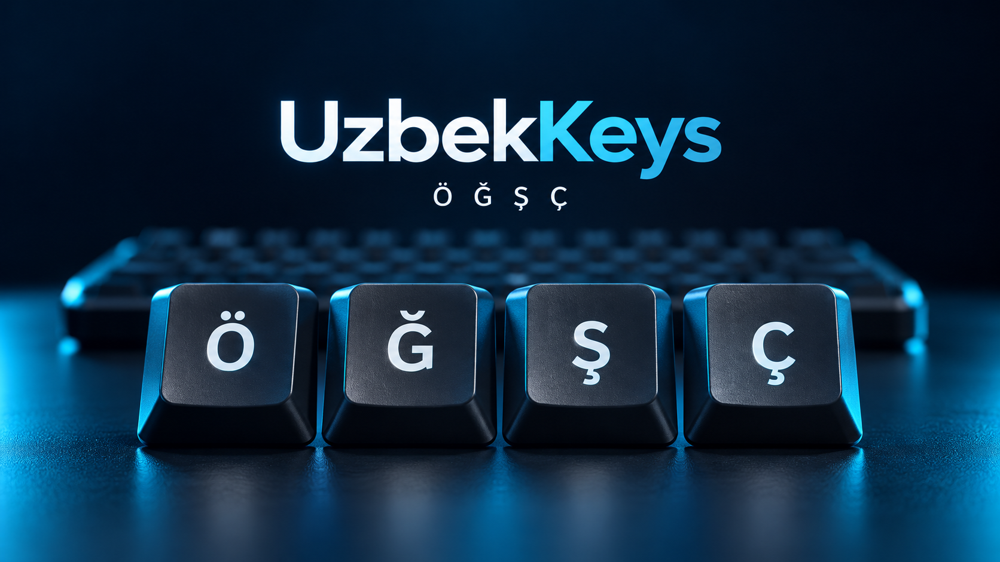
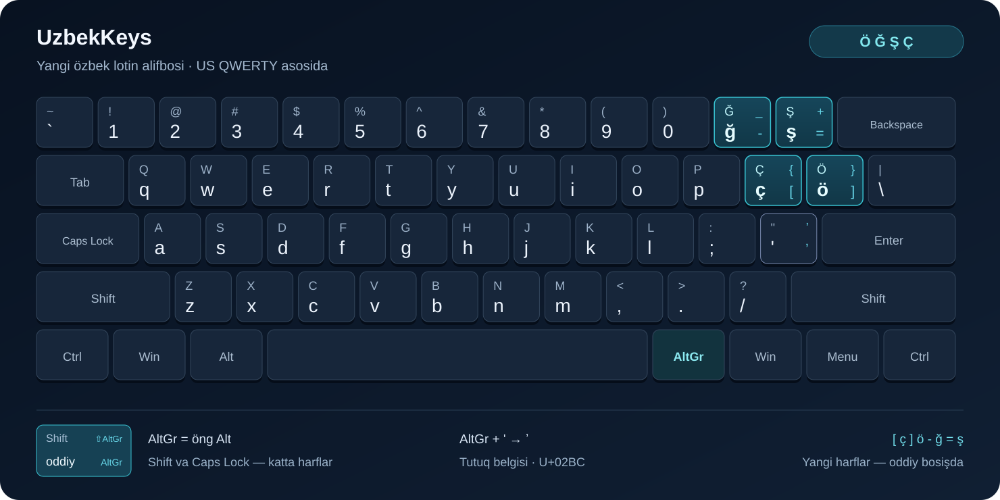

<div align="center">



# UzbekKeys

**Windows uçun yangi özbek lotin klaviaturasi.**

Ö, Ğ, Ş, Ç — taniş QWERTY joylaşuvida.

[](LICENSE)
[](#moslik)
[](https://github.com/Shohruh04/UzbekKeys/releases/latest)

[**Yuklab oliş**](https://github.com/Shohruh04/UzbekKeys/releases/latest/download/UzbekKeys-Setup.exe) · [Barça fayllar](https://github.com/Shohruh04/UzbekKeys/releases/latest) · [Video](https://github.com/Shohruh04/UzbekKeys/releases/latest/download/UzbekKeys-Promo.mp4)

</div>

UzbekKeys yangi harflarni Windows’ning öz klaviatura mexanizmi orqali yozadi. Örnatilgandan söng **Win + Space** bilan tanlanadi. Yozib turiş uçun alohida dastur yoki fon xizmati talab qilinmaydi.

## Yuklab oliş

| Fayl | Vazifasi |
| --- | --- |
| [**UzbekKeys-Setup.exe**](https://github.com/Shohruh04/UzbekKeys/releases/latest/download/UzbekKeys-Setup.exe) | Örnatuvçi; kompyuter arxitekturasiga mos paketni tanlaydi. |
| [**UzbekKeys-Windows.zip**](https://github.com/Shohruh04/UzbekKeys/releases/latest/download/UzbekKeys-Windows.zip) | Örnatuvçi, öçiruvçi va foydalaniş fayllari. |
| [**UzbekKeys-Promo.mp4**](https://github.com/Shohruh04/UzbekKeys/releases/latest/download/UzbekKeys-Promo.mp4) | Remotion videosi, ElevenLabs özbekça ovozi va fon musiqasi bilan. |

Manba kodi **Code → Download ZIP** orqali yoki `git clone` bilan olinadi. Işga tayyor paketlar esa [Releases](https://github.com/Shohruh04/UzbekKeys/releases) sahifasida joylaşadi.

## Örnatiş

1. `UzbekKeys-Setup.exe` faylini yuklab oling va işga tuşiring.
2. Windows administrator ruxsatini sörasa, örnatişni tasdiqlang.
3. Örnatuvçi körsatmalariga amal qiling.
4. **Win + Space** ni bosing va **UzbekKeys** ni tanlang.

Agar tartib menyuda körinmasa, **Settings → Time & language → Language & region → Uzbek (Latin) → Language options → Add a keyboard** orqali **UzbekKeys** ni qöşing. Zarur bölsa, oçiq dasturlarni qayta oçing yoki Windows hisobidan çiqib qayta kiring.

Mavjud inglizça, rusça va boşqa klaviaturalar saqlanadi. UzbekKeys’ni standart klaviatura qiliş majburiy emas.

## Tugmalar joylaşuvi



| Jismoniy tugma | Oddiy | Shift | Öng Alt / AltGr | Öng Alt + Shift |
| --- | --- | --- | --- | --- |
| `[` | ç | Ç | `[` | `{` |
| `]` | ö | Ö | `]` | `}` |
| `-` | ğ | Ğ | `-` | `_` |
| `=` | ş | Ş | `=` | `+` |
| `'` | `'` | `"` | ʼ | ʼ |

- **Caps Lock** yangi harflarni katta yozadi; **Caps Lock + Shift** kiçik harflarni yozadi.
- AltGr orqali yoziladigan `[]{}-_=+` belgilariga Caps Lock taʼsir qilmaydi.
- **Öng Alt + apostrof** tutuq belgisi **ʼ** (`U+02BC`) ni yozadi. U oddiy `'` (`U+0027`) apostrofdan farq qiladi.
- Qolgan tugmalar **US QWERTY** tartibida qoladi.
- `sh → ş` yoki `ch → ç` kabi avtomatik almaştiriş yöq; yangi harflar jadvaldagi tugmalar bilan yoziladi.

## Öçiriş

UzbekKeys’ni ikki usulda olib taşlaş mumkin:

1. **Settings → Apps → Installed apps → UzbekKeys → Uninstall**.
2. Tarqatmadagi yoki örnatilgan **Program Files\UzbekKeys\Uninstall.exe** faylini işga tuşiriş.

Öçirişdan oldin boşqa klaviaturaga öting va UzbekKeys işlatayotgan dasturlarni yoping. Öçiruvçi faqat UzbekKeys’ni olib taşlaydi; boşqa klaviaturalar va hujjatlar saqlanadi. Windows qayta kiriş yoki qayta yuklaşni sörasa, körsatmaga amal qiling.

## Moslik

| Tizim | Paket arxitekturasi |
| --- | --- |
| Windows 10 | x86, x64, ARM64 |
| Windows 11 | x64, ARM64 |

Windows 11’ning x86 tizim talqini yöq. x64 yoki ARM64 tizimdagi 32-bit dasturlar alohida moslik holati hisoblanadi.

Paketlar uşbu arxitekturalar uçun yiğiladi. Windows 10 tizimi va haqiqiy ARM64 qurilmadagi amaliy moslik hali tasdiqlanmagan; yiğiş va PE tuzilmasini tekşiriş amaliy sinov örnini bosmaydi. Har bir relizning tekşiruv holati reliz izohlarida körsatiladi. Windows 7, 8.1, macOS va Linux bu loyiha paketlariga kirmaydi.

Ilk sinov relizi raqamli imzosiz tarqatiladi. Internetdan olingan örnatuvçida Windows noşirni tekşira olmasligi haqidagi xabar çiqarişi mumkin. Fayllarni faqat [uşbu repozitoriyning relizlaridan](https://github.com/Shohruh04/UzbekKeys/releases) oling va relizdagi SHA-256 qiymatlari bilan soliştiring.

## Manbadan yiğiş

Klaviaturaning asosiy manbasi — [`src/uzbkeys.klc`](src/uzbkeys.klc). Içki DLL nomi `uzbkeys.dll`, til kodi `uz-Latn-UZ`.

```powershell
git clone https://github.com/Shohruh04/UzbekKeys.git
cd UzbekKeys
powershell -ExecutionPolicy Bypass -File scripts/Build.ps1 -Bootstrap
```

Yiğiş uçun Windows x64 kompyuter, Python 3, .NET 8 SDK va internet aloqasi kerak. `-Bootstrap` yiğiş vositalarini tayyorlaydi. Klaviatura DLL fayllari MSKLC manbasidan yiğiladi; ARM64 uçun Zig 0.14.1, MSI paketlari uçun WiX 5 işlatiladi. Microsoft va boşqa uçinçi tomon vositalari loyiha litsenziyasiga kirmaydi, ular öz litsenziyalari asosida işlatiladi.

Tekşiriş:

```powershell
python scripts/test_layout.py
# Klaviatura örnatilgan bölsa:
python scripts/test_layout.py --installed
# Örnatilgan klaviaturani 32-bit va 64-bit jarayonlarda tekşiriş:
powershell -ExecutionPolicy Bypass -File scripts/Test-Installed.ps1
```

Tekşiruvlar DLL içidagi belgilar, arxitektura, katta/kiçik harflar va US QWERTY mosligini soliştiradi. Örnatilgan tartibni tekşiriş Windows’ning `ToUnicodeEx` mexanizmidan foydalanadi.

Video manbasi [`media/video`](media/video) papkasida. README rasmining yaratiş tavsifi [`docs/assets/hero-prompt.txt`](docs/assets/hero-prompt.txt) faylida saqlangan.

## Hissa qöşiş

Xato yoki taklif uçun [Issue oçing](https://github.com/Shohruh04/UzbekKeys/issues). Xabarda Windows talqini, kompyuter arxitekturasi, dastur nomi, bosilgan tugmalar va kutilgan natijani yozing.

## Litsenziya

Loyiha kodi **[MIT](LICENSE)** litsenziyasi ostida oçiq. © 2026 Shohruh04.
